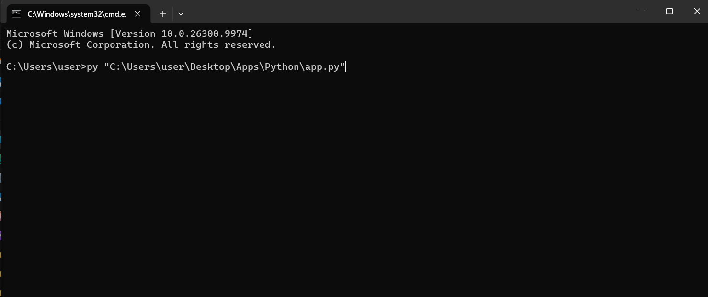
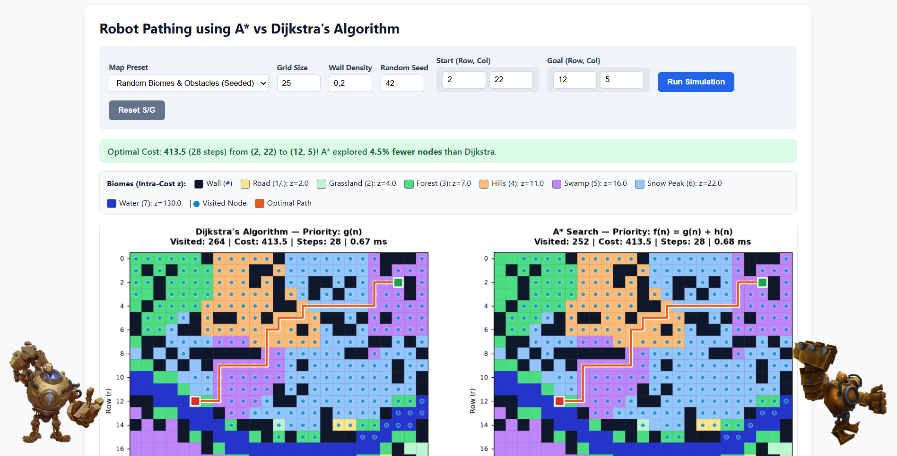
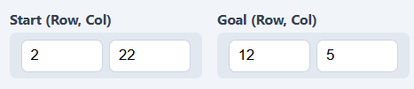
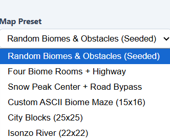
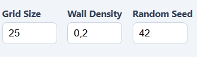
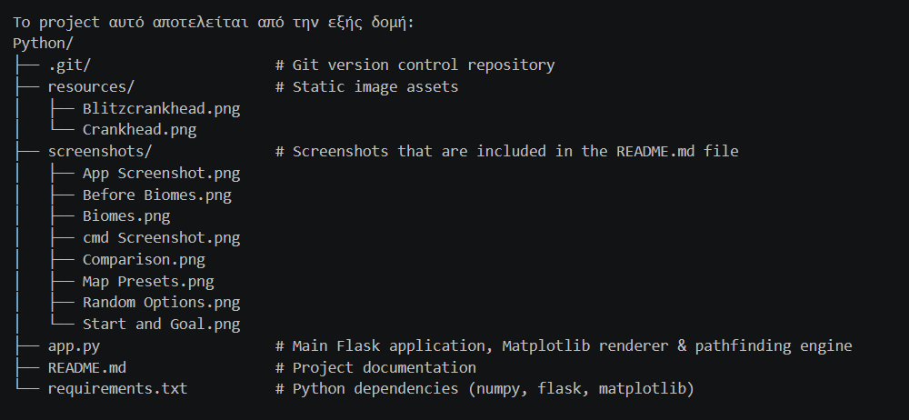
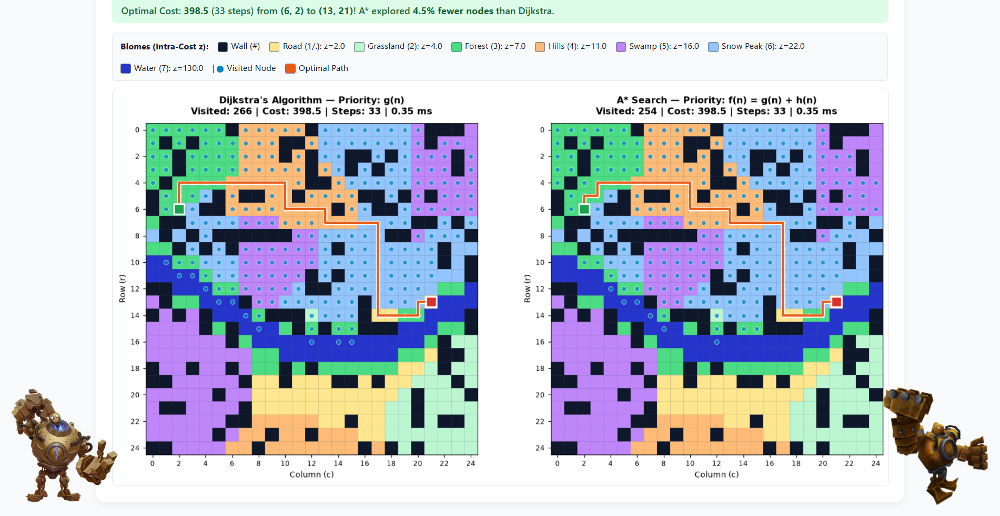
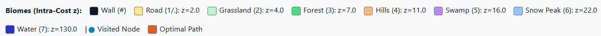
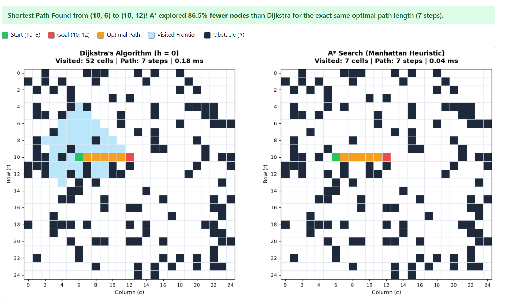

Το app αυτό διαθέτει κάποιες βιβλιοθήκες (που αναφέρονται στο requirements.txt) οι οποίες πρέπει να εγκαταστασταθούν από τον χρήστη.
Η εγκατάσταση αυτών των βιβλιοθηκών γίνεται με το εξής command στο terminal:
- pip install numpy, flask, matplotlib

---------------------------------------------------------------------------------------------------------------------------------

Επίσης, αυτό το πρόγραμμα τρέχεται σε Command Prompt. Για να γίνει αυτό ο χρήστης πρέπει να ακολουθήσει κάποια βήματα:
- Να πάει στο folder του project και να πατήσει δεξί κλικ στο app.py και να κάνει "Copy as Path"
- Μετά στο Command Prompt πρέπει να εκτελέσει την εξής εντολή (όπου %path% το path που ο χρήστης αντέγραψε νωρίτερα): py "%path%"

Στο πρόγραμμα αυτό βλέπουμε την σύγκριση 2 αλγορίθμων στην προσομοίωση πλοήγησης ενός robot σε έναν χώρο με ή χωρίς εμπόδια. 

O χρήστης καταρχάς έχει την δυνατότητα να αλλάξει το μέρος από το οποίο θα αρχίσει το robot και το που θα σταματήσει

Επιπρόσθετα, έχει την δυνατότητα να επιλέξει ανάμεσα σε διάφορα presets εκ των οποίων το default που φορτώνει η ιστοσελίδα είναι το: "Random Biomes and Obstacles (Seeded)"

Συγκεκριμένα στο "Random Biomes and Obstacles" preset ο χρήστης μπορεί να ελέγξει το μέγεθος του χάρτη, να δημιουργήσει άλλα random generated maps ανάλογα με το seed που θα βάλει και να ελέγξει το density με το οποίο θα εμφανιστούν τα εμπόδια.

---------------------------------------------------------------------------------------------------------------------------------

---------------------------------------------------------------------------------------------------------------------------------

Σε αυτό το project χρησιμοποιήθηκαν και οι 2 αλγόριθμοι (Α* και Dijkstra) και γίνεται σύγκριση μεταξύ τους για να δούμε ποίος αλγόριθμος είναι πιο γρήγορος στο να βρει την βέλτιστη διαδρομή.

Στους χάρτες έχουμε προσθέσει διάφορα "biomes" ετσι ώστε να δωθεί ποικιλία στα κόστη των ακμών. Για να δωθεί ακόμα μεγαλύτερη ποικιλία στα κόστη, στα σύνορα των biomes το κόστος ορίζεται από τον μέσο όρο του κόστους του κάθε biome.

Στην αρχική υλοποίηση του προγράμματος, παρατήρησα ότι ο Dijkstra εκφυλίζεται σε BFS, διότι πριν το addition των biomes όλες οι ακμές είχαν το ίδιο κόστος z και το κόστος διαδρομής γίνεται ανάλογο με τον αριθμό των ακμών, καταργώντας την ανάγκη για σύγκριση διαφορετικών βαρών.

Στον αλγόριθμο του Α* χρησιμοποιήθηκε η ευρετική Manhattan, καθώς ακολουθεί την φιλοσοφία του project (κουνιόμαστε οριζόντια και κάθετα) και δεν κάνει overestimate για 2 λόγους:
- Για τον τύπο της ευρετικής πολλαπλασιάζουμε το Manhattan distance με το ελάχιστο κόστος (z = 2.0), άρα η απόσταση είναι πάντα μικρότερη ή ίση της ευρετικής
- Θα υπερεκτιμούσε μόνο αν επιτρεπόταν η διαγώνια κίνηση. Τότε, ένα διαγώνιο βήμα θα κάλυπτε ταυτόχρονα απόσταση και στον άξονα x και στον άξονα y με κόστος τουλάχιστον 2, ενώ η ευρετική Manhattan θα το μετρούσε σαν 2 ξεχωριστά βήματα με ελάχιστο κόστος 2 (2*2 = 4 > 2) το οποίο εδώ δεν συμβαίνει.

Οι δύο αλγόριθμοι έχουν μεγάλες διαφορές μεταξύ τους:
- Αλγόριθμος Dijkstra: Εξερευνά τους κόμβους ομοιόμορφα προς όλες τις κατευθύνσεις. Υπολογίζει μόνο το κόστος g(n) από την αφετηρία μέχρι το τρέχον σημείο, χωρίς να γνωρίζει πού βρίσκεται ο τελικός προορισμός.
- Αλγόριθμος A* : Υπολογίζει το συνολικό εκτιμώμενο κόστος f(n) = g(n) + h(n), όπου το h(n) είναι η ευρετική, δηλαδή μια έξυπνη εκτίμηση (εδώ ή απόσταση Manhattan επί το ελάχιστο κόστος ακμής) μέχρι τον στόχο. Έτσι, δίνει προτεραιότητα στα μονοπάτια που δείχνουν να πλησιάζουν τον προορισμό και αγνοεί όσα απομακρύνονται.

Προσωπικά, προτείνω τον αλγόριθμο A* για την πλοήγηση ενός robot σε χώρο που γνωρίζουμε, όπως εδώ που μας δίνεται ο χάρτης, μία αρχή, ένα τέλος και τα εμπόδια, διότι είναι ο πιο αποτελεσματικός και όπως συμπεραίνουμε χρησιμοποιεί τους λιγότερους πόρους ως Informed Algorithm σε αντίθεση με τον αλγόριθμο Dijkstra που είναι Uninformed.
